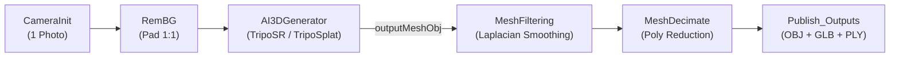

# mrAIGen3D: Single-Image AI 3D Reconstruction & Gaussian Splatting for AliceVision Meshroom

<div align="center">

[](https://stability.ai/)
[](https://github.com/alicevision/meshroom)
[](https://developer.nvidia.com/cuda-toolkit)
[](LICENSE)
[]()

**Transform a single 2D photograph into textured 3D meshes (.obj / .glb) and 3D Gaussian Splats (.ply) in seconds.**  
*Optimized for laptops with 4.0 GB VRAM (NVIDIA GeForce RTX 3050) & backed by a Google Colab GPU bridge for heavy cloud models.*

</div>

---

## 1. Overview

`mrAIGen3D` is an official-grade AliceVision Meshroom plugin that introduces the **`AI3DGenerator`** node. It eliminates the traditional requirement of taking 30–150+ overlapping photos: **a single picture is all that is needed to generate a watertight 3D model.**



---

## 2. Supported AI Models

| Model ID | Origin & Architecture | Execution Target | VRAM Usage | Output Format |
| :--- | :--- | :--- | :--- | :--- |
| **`triposr`** | [Stability AI & Tripo](https://huggingface.co/stabilityai/TripoSR) | **Local Laptop GPU (RTX 3050 4GB)** | **~2.8 GB** (`chunk=4096`, `mc=192`) | `.obj` (Viewport) + `.glb` (PBR) |
| **`triposplat`** | [VAST-AI Research & Tripo](https://github.com/VAST-AI-Research/TripoSplat.git) | **Local Laptop GPU (RTX 3050 4GB)** | **~3.2 GB** (131k points) | `.ply` (3D Gaussian Splats) |
| **`stable-fast-3d`** | [Stability AI](https://huggingface.co/stabilityai/stable-fast-3d) | Remote Worker (Colab T4 16GB) | ~6.0 GB | `.glb` (UV-unwrapped PBR) |
| **`spar3d`** | [Stability AI](https://github.com/Stability-AI/stable-point-aware-3d) | Remote Worker (Colab T4 16GB) | ~7.0 GB | `.glb` + `.ply` |
| **`trellis-large`** | [Microsoft](https://github.com/microsoft/TRELLIS) | Remote Worker (Colab T4 16GB) | ~8.0–10.0 GB (FP16) | `.glb` + `.ply` (3DGS) |
| **`trellis-2-4b`** | [Microsoft](https://github.com/microsoft/trellis.2) | Remote Worker (Colab L4 / A100) | ~14.0 GB | `.glb` (High-Res Mesh) |
| **`hunyuan3d-2.1`** | [Tencent](https://github.com/tencent-hunyuan/hunyuan3d-2.1) | Remote Worker (Colab T4 16GB) | 2-Stage Sequential Unload | `.obj` + `.glb` (PBR Textures) |

---

## 3. Laptop Hardware Optimizations (RTX 3050 4GB VRAM)

Running 3D generative AI models on a 4GB VRAM consumer laptop GPU without Out-of-Memory crashes is made possible by:
1. **NeRF Chunk Slicing (`chunkSize = 4096`):** Evaluates dense grid points in small sequential batches instead of full volume passes.
2. **Optimized Marching Cubes (`mcResolution = 192`):** Extracts ~26,000 vertices and ~53,000 faces in ~4 seconds, fitting safely inside 4.0 GB VRAM.
3. **Scikit-Image CPU Fallback:** Automatically substitutes C++ `torchmcubes` with `skimage.measure.marching_cubes` if compiled extensions are unavailable.
4. **Proactive VRAM Purging:** Calls `torch.cuda.empty_cache()` and `gc.collect()` at the end of each generation cycle.

---

## 4. Installation into Meshroom

Run the automated registration script:
```powershell
powershell -ExecutionPolicy Bypass -File D:\Meshroom\mrAIGen3D\scripts\register_plugin_windows.ps1
```
This registers:
- Plugin junction: `D:\Meshroom\Meshroom-2025.1.0\plugins\mrAIGen3D`.
- Pipeline template: `AIGen3D.mg` into `aliceVision\share\meshroom`.

---

## 5. Node Specification: `AI3DGenerator`

- **Category:** `AI Generation / 3D Reconstruction`
- **GPU Level:** `desc.Level.INTENSIVE`

### Inputs
| Parameter | Type | Default | Description |
| :--- | :--- | :--- | :--- |
| `input` | `desc.File` | `""` | Single unified input: SfMData from `RemBG.outputSfm` / `CameraInit.output`, directory of images, or direct single image file (`.png`/`.jpg`). |
| `selectedViewIndex` | `desc.IntParam` | `0` | View index to reconstruct if input contains multiple images. |
| `modelName` | `desc.ChoiceParam` | `"triposr"` | AI 3D Model (`triposr`, `triposplat`, `spar3d`, etc.). |
| `executionBackend` | `desc.ChoiceParam` | `"local_wsl_gpu"` | Backend (`local_wsl_gpu`, `local_cpu`, `colab_remote`). |
| `remoteEndpointUrl` | `desc.StringParam` | `""` | Public HTTP tunnel URL from Google Colab worker. |
| `mcResolution` | `desc.ChoiceParam` | `"192"` | Marching cubes grid resolution (`192`, `256`, `384`). |
| `chunkSize` | `desc.ChoiceParam` | `"4096"` | NeRF renderer chunk size (`2048`, `4096`, `8192`). |
| `numGaussians` | `desc.ChoiceParam` | `"131072"` | Point count for TripoSplat 3DGS (`32768` – `262144`). |
| `textureResolution` | `desc.ChoiceParam` | `"1024"` | Texture map dimension in pixels (`512`, `1024`, `2048`). |
| `lowVramMode` | `desc.BoolParam` | `True` | Enables sequential stage unloading and memory offload. |

### Outputs
| Output Attribute | Type | Path & Semantic | Description |
| :--- | :--- | :--- | :--- |
| `outputMeshObj` | `desc.File` | `{nodeCacheFolder}/mesh.obj` (`3d`) | **Directly rendered in Meshroom 3D Viewport.** |
| `outputMeshGlb` | `desc.File` | `{nodeCacheFolder}/asset_pbr.glb` | Complete Binary glTF asset with full PBR materials. |
| `outputGaussianPly` | `desc.File` | `{nodeCacheFolder}/gaussian.ply` (`3d`) | 3D Gaussian Splats point cloud for TripoSplat. |
| `outputPreviewPng` | `desc.File` | `{nodeCacheFolder}/preview.png` (`image`) | Preview of the single input image in 2D viewer. |

---

## 6. Pipeline Template

**`AIGen3D.mg`**:
`CameraInit` (1 Photo) $\rightarrow$ `RemBG` (Pad 1:1) $\rightarrow$ `AI3DGenerator` (TripoSR / TripoSplat) $\rightarrow$ `Publish`.  
*Automates background matting, feed-forward 3D neural reconstruction in ~4 seconds, and exports OBJ, GLB, and PLY.*

---

## 7. Google Colab GPU Worker (Cloud Bridge)

For running heavyweight models (SF3D, SPAR3D, TRELLIS, Hunyuan3D-2.1):
1. Open [Meshroom_AI3D_Colab_Worker.ipynb](colab/Meshroom_AI3D_Colab_Worker.ipynb) in Google Colab.
2. Select a GPU runtime (T4, L4, or A100).
3. Run the notebook to launch the FastAPI server and Cloudflared tunnel.
4. Copy the resulting `trycloudflare.com` URL into `remoteEndpointUrl` in Meshroom.
5. Set `executionBackend = "colab_remote"`.

---

## 8. Verification & Unit Tests

Run the test suite on Windows:
```powershell
C:\Users\Nyfa\miniconda3\python.exe D:\Meshroom\mrAIGen3D\tests\test_ai3d.py
```

---

## 9. Legal Attribution & License

- Wrapper code is licensed under the [Mozilla Public License 2.0 (MPL-2.0)](LICENSE).
- **Stability AI Attribution:**  
  *This Stability AI Model is licensed under the Stability AI Community License, Copyright © Stability AI Ltd. All Rights Reserved. Powered by Stability AI.* See [Notice](Notice) and [LICENSE_STABILITY_AI.md](LICENSE_STABILITY_AI.md).
- **TripoSplat Attribution:** Provided by VAST-AI Research & Tripo AI under the MIT license.
