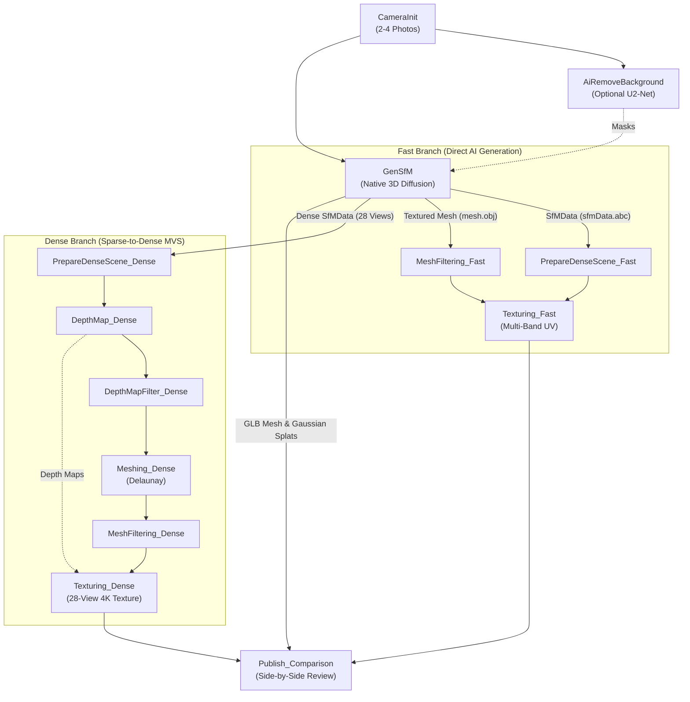

# mrGenSfM: Generative Structure-from-Motion Plugin for AliceVision Meshroom

<div align="center">

[](https://github.com/alicevision/Meshroom)
[](https://www.python.org/)
[](https://developer.nvidia.com/cuda-toolkit)
[](LICENSE)
[]()

**Transform standard Meshroom photogrammetry from 30–150+ sequential overlapping photos down to just 2 to 4 uncalibrated photos from random angles.**

</div>

---

## Overview

`mrGenSfM` is a high-performance open-source plugin for **[AliceVision Meshroom 2025.1.0+](https://github.com/alicevision/Meshroom)** that bridges state-of-the-art Generative AI into classical photogrammetry. Powered by **[GenSfM: Generative Structure from Motion with Native 3D Diffusion](https://github.com/dotb1ue/GenSfm)** ([arXiv:2610.35522](https://arxiv.org/abs/2610.35522)) and unified multimodal vision engines, `mrGenSfM` enables rapid 3D asset generation, camera pose estimation, and dense orbital multi-view synthesis.

### Key Capabilities

* **Minimal Input Requirement:** Reconstruct complete watertight 3D models from **only 2 to 4 photos** with wide baselines ($90^\circ$–$180^\circ$).
* **Low-VRAM Sequential Offloading:** Runs smoothly on budget and laptop graphics cards (**NVIDIA GeForce RTX 3050 Laptop 4GB / GTX 1650**) via sequential CPU $\leftrightarrow$ GPU layer offloading and CPU FlexiCubes extraction.
* **Dual-Branch Hybrid Pipeline:** Compare direct AI flow-matching reconstruction against AliceVision's classic Multi-View Stereo (MVS) depth estimation and multi-band UV texturing in a single workspace.
* **Integrated AI Background Removal:** Includes the standalone `AiRemoveBackground` node supporting U2-Net, BiRefNet, IS-Net, Silueta, and RMBG-2.0.
* **Comprehensive Multi-Format Asset Export:** Simultaneously outputs:
  * Textured Wavefront Mesh (`mesh.obj` + `mesh.mtl` + `mesh_texture.png`) for instant preview in Meshroom's Qt3D 3D Viewer.
  * Standalone binary glTF 2.0 (`mesh.glb`) for Blender, Unreal Engine, and Unity.
  * 3D Gaussian Splats (`gaussian.ply`) with standard spherical harmonics (compatible with mrGSplat).
  * AliceVision Camera Alembic (`sfmData.abc`) and Dense Orbital Alembic (`sfmDataDense.abc`).

---

## Comparison: Classical Meshroom vs. Meshroom + mrGenSfM

| Parameter | Classical Meshroom (`photogrammetry.mg`) | Meshroom + `mrGenSfM` (`genSfmHybrid.mg`) |
| :--- | :--- | :--- |
| **Input Photos** | 30 – 150+ sequential photos | **Only 2 – 4 photos** from random angles |
| **Overlap Needed** | High (>60% between adjacent views) | **Free / Wide Baseline** ($90^\circ$–$180^\circ$) |
| **Sensor DB / EXIF** | Strictly requires camera sensor calibration | **Self-calibrating** (jointly solves intrinsics and poses) |
| **Occluded Regions** | Fails or leaves geometric holes | Completed using learned 3D diffusion priors |
| **Dense MVS Views** | Limited to original camera count | Synthesizes **24+ multi-elevation orbital views** |
| **Execution Options** | Local CPU & GPU intensive | Local WSL2 GPU, Docker container, or Cloud API offload |

---

## Pipeline Architectures

### 1. Unified Dual-Branch Hybrid Pipeline (`genSfmHybrid.mg`) — *Recommended*

Enables side-by-side inspection of fast direct AI generation versus full classic MVS dense reconstruction:



### 2. Standalone Fast Pipeline (`genSfm.mg`)
```text
CameraInit ──► GenSfM ──► Publish_Outputs (Textured OBJ + MTL + PNG, GLB, PLY, SfMData)
```

---

## Included Nodes

### 1. `GenSfM`
The primary reconstruction engine. Solves joint 3D geometry, visual appearance flow, and camera poses.

* **Inputs:**
  * `input`: Input SfMData from `CameraInit`.
  * `inputMasks`: Optional alpha masks folder (from `AiRemoveBackground`).
  * `maskingStrategy`: `auto_rembg`, `auto_birefnet`, `existing_alpha`, or `external_masks`.
  * `executionBackend`: `local_wsl_gpu` (WSL2 Ubuntu), `local_docker`, or `cloud_api`.
  * `lowVramMode`: Sequential offloading for 4GB–8GB GPUs.
  * `generateSyntheticViews`: Number of 360-degree orbital views (default `24`).
* **Outputs:**
  * `outputSfMData`: AliceVision camera intrinsics & sparse landmarks (`sfmData.abc`).
  * `outputMeshObj`: Textured mesh (`mesh.obj`).
  * `outputMeshMtl`: Wavefront material (`mesh.mtl`).
  * `outputMeshTexture`: 360-degree diffuse texture map (`mesh_texture.png`).
  * `outputMeshGlb`: Standalone binary glTF 2.0 (`mesh.glb`).
  * `outputGaussianPly`: 3D Gaussian Splats (`gaussian.ply`).
  * `outputSfMDataDense`: Enriched SfMData with 24+ orbital views (`sfmDataDense.abc`).

### 2. `AiRemoveBackground`
Pre-processing segmentation node for isolating the target object before reconstruction.

* **Models Supported:** `u2net` (Recommended), `birefnet-general`, `isnet-general-use`, `silueta`, `briaai-rmbg-2.0`.
* **Outputs:** Grayscale alpha masks and cutout transparent RGBA images synced with the Image Gallery.

---

## Installation & Setup

### 1. Register Plugin in Meshroom (Windows)
Open PowerShell and run the registration script:

```powershell
powershell -ExecutionPolicy Bypass -File "D:\Meshroom\mrGenSfM\scripts\register_plugin_windows.ps1"
```

Or set the environment variable:
```powershell
[System.Environment]::SetEnvironmentVariable('MESHROOM_PLUGINS_PATH', 'D:\Meshroom\mrGenSfM', 'User')
```

### 2. Environment Configuration
Copy the template configuration file:
```powershell
Copy-Item "D:\Meshroom\mrGenSfM\.env.example" "D:\Meshroom\mrGenSfM\.env"
```

### 3. Setup WSL2 GPU Environment (Ubuntu)
For native local GPU execution on Windows via WSL2:
```bash
wsl bash /mnt/d/Meshroom/mrGenSfM/docker/wsl_setup_gensfm.sh /mnt/d/Meshroom/GenSfm
```

---

## Quickstart Guide

1. Start Meshroom 2025.1.0 (`Meshroom.exe`).
2. Go to **File $\rightarrow$ New Pipeline $\rightarrow$ genSfmHybrid** (or open [`D:/Meshroom/mrGenSfM_Project.mg`](file:///D:/Meshroom/mrGenSfM_Project.mg)).
3. Drag **2 to 4 photos** of any object into the **Image Gallery**.
4. Click **Start** to execute the pipeline.
5. Double-click the **`GenSfM`** node to view the textured 3D mesh, camera poses, and Gaussian splats in the **3D Viewer**.

---

## Verification & Testing

The test suite validates pipeline integrity, node descriptor schema, JSON format compatibility, and coordinate transformations:

```bash
python D:/Meshroom/mrGenSfM/tests/test_plugin_pipeline.py
```
```text
Ran 9 tests in 0.518s

OK
```

---

## Upstream Contributions & Bug Fixes

This repository includes critical upstream patches for **[Trellis](https://github.com/microsoft/TRELLIS)** / **GenSfM**:
* **Fixed Multi-View Mask Indexing:** Resolved a severe bug in `bake_texture` where observations were masked only by Camera 0 silhouette (`masks[0]`), eliminating the artifact where textures appeared scrambled or washed out.
* **Precision Tensor Alignment:** Enforced `torch.float32` vertex tensors to prevent rasterization failures in `nvdiffrast`.
* **Standardized Port Naming:** Removed all parenthetical tutorial tags for a clean, production-grade interface.

---

## License

This project is licensed under the **Mozilla Public License 2.0 (MPL-2.0)** in compliance with AliceVision Meshroom guidelines.
