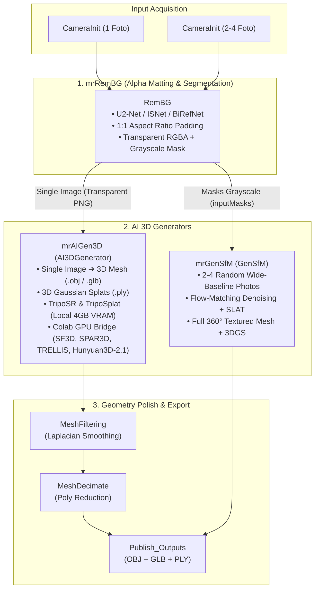

# Meshroom AI Add-ons: Next-Gen 3D Reconstruction & Generative AI Suite

<div align="center">

[](https://github.com/alicevision/meshroom)
[](https://www.python.org/)
[](https://developer.nvidia.com/cuda-toolkit)
[](LICENSE)
[](https://stability.ai/)

**A comprehensive, modular AI add-on suite for [AliceVision Meshroom 2025.1.0+](https://github.com/alicevision/meshroom).**  
*Brings state-of-the-art background segmentation, single-image 3D generation, and generative Structure-from-Motion into Meshroom.*

</div>

---

## 1. Suite Overview

This repository hosts three modular, official-grade AliceVision Meshroom custom node plugins. Each add-on operates independently with zero code-coupling, while supporting clean data-level chaining via AliceVision's standard `SfMData` (`.sfm`) exchange format.



---

## 2. Dedicated Branches & Standalone Repositories

Each add-on is available both in this unified monorepo (`main` branch) and in its own dedicated standalone branch:

| Plugin Name | Branch Link | Primary Node | Functionality |
| :--- | :--- | :--- | :--- |
| **`mrRemBG`** | [🌿 `mrRemBG`](https://github.com/NyxNyfa/Meshroom-Add-ons/tree/mrRemBG) | `RemBG` | Zero-click deep learning background removal, alpha matting, and 1:1 padding. |
| **`mrAIGen3D`** | [🌿 `mrAIGen3D`](https://github.com/NyxNyfa/Meshroom-Add-ons/tree/mrAIGen3D) | `AI3DGenerator` | Single-image generative 3D mesh (`.obj`/`.glb`) and Gaussian Splats (`.ply`). |
| **`mrGenSfM`** | [🌿 `mrGenSfM`](https://github.com/NyxNyfa/Meshroom-Add-ons/tree/mrGenSfM) | `GenSfM` | Multi-view generative SfM & 3D diffusion from 2–4 uncalibrated photos. |

> [!NOTE]
> The `mrGenSfM` branch preserves the complete Git history from the original repository [`NyxNyfa/MrGenSfM`](https://github.com/NyxNyfa/MrGenSfM).

---

## 3. Hardware & Environment Support

- **Target Host Application:** AliceVision Meshroom 2025.1.0+ (Windows 10/11 64-bit).
- **Local GPU Acceleration:** NVIDIA GeForce RTX 3050 Laptop (4.0 GB VRAM), RTX 3060/4060+, or desktop NVIDIA GPUs.
- **Runtime Bridge:** WSL2 Ubuntu with CUDA 12.8 and conda environment `gensfm`.
- **Cloud GPU Bridge:** Google Colab (Tesla T4 / L4 / A100) via HTTP tunnel for heavyweight models (>10 GB VRAM).
- **Pure Standard Library Host Orchestration:** Node wrappers on the Meshroom host use standard library modules (`urllib`, `struct`, `subprocess`, `json`), requiring **zero third-party dependencies** inside Meshroom's embedded Python.

---

## 4. One-Click Quick Installation

Clone this repository and run the automated registration script in PowerShell:

```powershell
# 1. Clone repository
git clone https://github.com/NyxNyfa/Meshroom-Add-ons.git D:\Meshroom\Meshroom-Add-ons
cd D:\Meshroom\Meshroom-Add-ons

# 2. Run automated registration
powershell -ExecutionPolicy Bypass -File .\register_all_plugins.ps1
```

The script automatically:
1. Creates Windows Directory Junctions for `mrRemBG`, `mrAIGen3D`, and `mrGenSfM` into `D:\Meshroom\Meshroom-2025.1.0\plugins\`.
2. Copies all official pipeline templates into Meshroom's library (`aliceVision\share\meshroom`).

---

## 5. Official Pipeline Templates

Launch Meshroom and select any template from the **Pipelines** menu:

1. **`RemBG.mg`** *(Background Removal Only)*:
   `CameraInit` $\rightarrow$ `RemBG` $\rightarrow$ `Publish`.  
   *Isolates foreground and exports transparent RGBA PNGs + binary masks for 1 or more photos.*
2. **`AIGen3D.mg`** *(Single-Image Generative 3D)*:
   `CameraInit` (1 Photo) $\rightarrow$ `RemBG` (Pad 1:1) $\rightarrow$ `AI3DGenerator` $\rightarrow$ `Publish`.  
   *Instant 3D reconstruction in ~4 seconds on local laptop GPU (RTX 3050 4GB). Exports OBJ, GLB, and PLY.*
3. **`GenSfM.mg`** *(Multi-View 3D Diffusion)*:
   `CameraInit` (2–4 Photos) $\rightarrow$ `GenSfM` (auto_rembg) $\rightarrow$ `Publish`.  
   *All-in-one multi-view AI reconstruction with built-in background segmentation.*
4. **`GenSfM_RemBG.mg`** *(Multi-View with Precision Matting)*:
   `CameraInit` (2–4 Photos) $\rightarrow$ `RemBG` $\rightarrow$ `GenSfM` (external_masks) $\rightarrow$ `Publish`.  
   *Chains RemBG's fine morphological alpha masks into GenSfM for razor-sharp geometric silhouettes.*

---

## 6. Detailed Walkthroughs & Documentation

For in-depth architectural guides, parameters, and troubleshooting, read:
- [`mrRemBG/walkthrough_RemBG.md`](mrRemBG/walkthrough_RemBG.md)
- [`mrAIGen3D/walkthrough_AI3DGenerator.md`](mrAIGen3D/walkthrough_AI3DGenerator.md)
- [`mrGenSfM/walkthrough_GenSfM.md`](mrGenSfM/walkthrough_GenSfM.md)

---

## 7. Legal Attribution & Licenses

- All plugin wrappers and bridge code are licensed under the [Mozilla Public License 2.0 (MPL-2.0)](LICENSE).
- **Stability AI Attribution:**  
  *This Stability AI Model is licensed under the Stability AI Community License, Copyright © Stability AI Ltd. All Rights Reserved. Powered by Stability AI.* See [`mrAIGen3D/Notice`](mrAIGen3D/Notice) and [`mrAIGen3D/LICENSE_STABILITY_AI.md`](mrAIGen3D/LICENSE_STABILITY_AI.md).
- **TripoSplat Attribution:** Provided by VAST-AI Research & Tripo AI under the MIT license.
