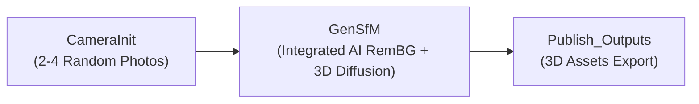

# mrGenSfM: All-in-One Generative Structure-from-Motion Node for AliceVision Meshroom

<div align="center">

[](https://github.com/alicevision/Meshroom)
[](https://www.python.org/)
[](https://developer.nvidia.com/cuda-toolkit)
[](LICENSE)
[]()

**A single modular node that reconstructs complete watertight 3D models and 3D Gaussian Splats from just 2 to 4 uncalibrated photos with zero overlapping constraints.**

</div>

---

## Overview

`mrGenSfM` is an official-grade plugin for **[AliceVision Meshroom 2025.1.0+](https://github.com/alicevision/Meshroom)** that compresses the entire photogrammetry workflow into a single, highly-optimized node: **`GenSfM`**.

Powered by native 3D Flow-Matching diffusion ([arXiv:2610.35522](https://arxiv.org/abs/2610.35522)), `GenSfM` replaces complex, fragile multi-node photogrammetry graphs (*FeatureExtraction $\rightarrow$ FeatureMatching $\rightarrow$ StructureFromMotion $\rightarrow$ PrepareDenseScene $\rightarrow$ DepthMap $\rightarrow$ Meshing $\rightarrow$ Texturing*) with an all-in-one generative pipeline:



---

## Why mrGenSfM?

| Feature | Standard Photogrammetry Graph | mrGenSfM (`GenSfM` Node) |
| :--- | :--- | :--- |
| **Input Photos** | 30 – 150+ sequential photos | **Only 2 to 4 photos** |
| **View Angles** | Strict high overlap (>60%) | **Random angles** ($90^\circ$–$180^\circ$ wide baseline) |
| **Camera Calibration** | Strict camera sensor database match | **Fully automatic** (jointly solves poses & intrinsics) |
| **Background Removal** | Requires manual masking / separate nodes | **Built-in AI Background Removal** (U2-Net / RemBG) |
| **Pipeline Complexity** | 8 to 12 interconnected nodes | **1 Single Reconstruction Node** |
| **Hardware Compatibility** | Requires workstation GPUs & large RAM | **Optimized for 4GB GPUs** (RTX 3050 Laptop / GTX 1650) |
| **Output Assets** | Single OBJ or Alembic point cloud | **Textured OBJ+MTL+PNG, GLB, PLY, and SfMData** |

---

## Built-in Capabilities Inside `GenSfM`

The `GenSfM` node encapsulates 5 automated stages within a single compute execution:

1. **Integrated AI Background Removal:**
   Automatically isolates the foreground object using deep learning segmentation (`u2net`) before reconstruction, removing background clutter without requiring external masking nodes.
2. **Joint Camera Pose & Sparse Structure Estimation (Stage 1):**
   Estimates relative camera positions, focal lengths, and sparse 3D point cloud landmarks directly from uncalibrated viewpoints.
3. **Generative 3D Shape & Appearance Diffusion (Stage 2):**
   Synthesizes continuous 3D geometric surfaces and photorealistic appearance representations using sparse latent flow matching.
4. **Low-VRAM Sequential Offloading (4GB–8GB GPU Support):**
   Utilizes sequential CPU $\leftrightarrow$ GPU layer offloading and CPU-offloaded FlexiCubes extraction to stay safely within **4.0 GB VRAM** (e.g. NVIDIA GeForce RTX 3050 Laptop GPU).
5. **Multi-View 360° Texture Baking:**
   Renders 100 orbital views around the generated appearance representation and bakes an unwrapped, seamless 1024x1024 UV texture atlas onto the polygon mesh.

---

## Output Assets

Every execution directly populates your destination folder (via `Publish_Outputs`) with production-ready assets:

* **Textured Wavefront Mesh (`mesh.obj` + `mesh.mtl` + `mesh_texture.png`):**
  Full diffuse texture atlas, immediately viewable in Meshroom's native Qt3D 3D Viewer.
* **glTF 2.0 Binary Mesh (`mesh.glb`):**
  Standard Y-up coordinate asset with embedded PBR materials for Blender, Unreal Engine, and Unity.
* **3D Gaussian Splats (`gaussian.ply`):**
  Complete 3D Gaussian Splatting point cloud with spherical harmonics colors, fully compatible with `mrGSplat` and web viewers.
* **AliceVision SfMData (`sfmData.abc`):**
  Alembic camera poses and sparse landmarks for downstream nodes or camera tracking.

---

## Installation & Registration

### 1. Register in Meshroom (Windows)
Run the automated registration script in PowerShell:

```powershell
powershell -ExecutionPolicy Bypass -File "D:\Meshroom\mrGenSfM\scripts\register_plugin_windows.ps1"
```

Or configure via environment variable:
```powershell
[System.Environment]::SetEnvironmentVariable('MESHROOM_PLUGINS_PATH', 'D:\Meshroom\mrGenSfM', 'User')
```

### 2. Environment Configuration
Copy the configuration template:
```powershell
Copy-Item "D:\Meshroom\mrGenSfM\.env.example" "D:\Meshroom\mrGenSfM\.env"
```

### 3. Setup WSL2 GPU Environment (Ubuntu)
For local GPU execution on Windows:
```bash
wsl bash /mnt/d/Meshroom/mrGenSfM/docker/wsl_setup_gensfm.sh /mnt/d/Meshroom/GenSfm
```

---

## Quickstart Guide

1. Launch Meshroom 2025.1.0 (`Meshroom.exe`).
2. Go to **File $\rightarrow$ New Pipeline $\rightarrow$ genSfm** (or open [`mrGenSfM_Project.mg`](file:///D:/Meshroom/mrGenSfM_Project.mg)).
3. Drag **2 to 4 photos** of any object into the **Image Gallery**.
4. Click **Start** (or run `meshroom_compute.exe`).
5. Double-click the **`GenSfM`** node to view the textured 3D mesh, camera poses, and Gaussian splats in the **3D Viewer**.

---

## Node Reference: `GenSfM`

### Key Parameters
* `input`: Input SfMData connection from `CameraInit` or `RemBG.outputSfm`.
* `inputMasks`: Path to external masks folder when using `RemBG.outputMasks`.
* `maskingStrategy`: `auto_rembg` (*Default*, automatic U2-Net segmentation), `existing_alpha` (pre-cut PNGs), or `external_masks` (integrated with `mrRemBG`).
* `executionBackend`: `local_wsl_gpu` (*Default*, native local GPU via WSL2), `local_docker`, or `cloud_api`.
* `lowVramMode`: `True` (*Default*, enables CPU-GPU offloading for 4GB–8GB GPUs).
* `seed`: Random seed for deterministic generation (default: `1`).
* `steps`: Flow-matching denoising steps (default: `25`).

### Official Pipeline Templates
1. **`GenSfM.mg`**: Standard all-in-one AI reconstruction (`CameraInit` $\rightarrow$ `GenSfM` $\rightarrow$ `Publish`).
2. **`GenSfM_RemBG.mg`**: Modular pipeline chained with `mrRemBG` (`CameraInit` $\rightarrow$ `RemBG` $\rightarrow$ `GenSfM` $\rightarrow$ `Publish`).

### Output Attributes
* `outputMeshObj`: Textured mesh (`mesh.obj`).
* `outputMeshMtl`: Material definition (`mesh.mtl`).
* `outputMeshTexture`: Diffuse texture map (`mesh_texture.png`).
* `outputMeshGlb`: Standalone binary glTF 2.0 (`mesh.glb`).
* `outputGaussianPly`: 3D Gaussian Splats (`gaussian.ply`).
* `outputSfMData`: AliceVision camera intrinsics & sparse landmarks (`sfmData.abc`).

---

## Verification & Testing

Verify plugin integrity and compatibility:

```bash
python D:/Meshroom/mrGenSfM/tests/test_plugin_pipeline.py
```
```text
Ran 9 tests in 0.518s

OK
```

---

## License

Released under the **Mozilla Public License 2.0 (MPL-2.0)** in compliance with AliceVision Meshroom guidelines.
