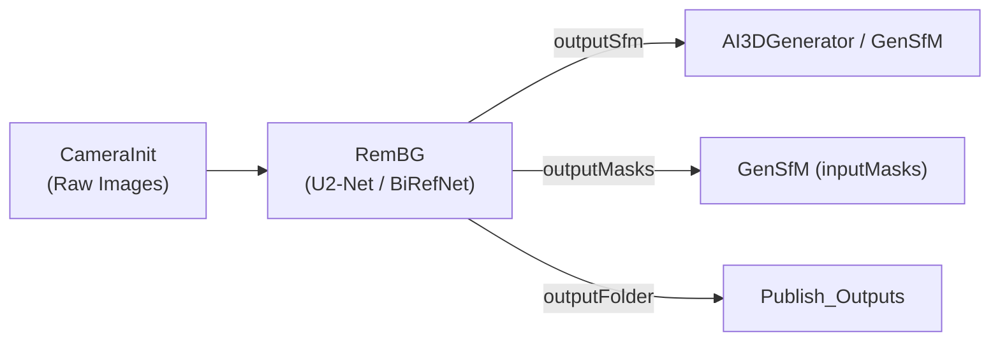

# mrRemBG: AI Background Removal & Foreground Matting Plugin for AliceVision Meshroom

<div align="center">

[](https://github.com/alicevision/meshroom)
[](https://www.python.org/)
[](https://developer.nvidia.com/cuda-toolkit)
[](LICENSE)
[]()

**A modular, AI-powered background removal and alpha matting node for AliceVision Meshroom.**  
*Effortlessly isolates foreground objects, updates SfMData camera views, and generates transparent RGBA assets and binary masks.*

</div>

---

## 1. Overview

`mrRemBG` provides a dedicated, high-performance node (`RemBG`) inside **AliceVision Meshroom 2025.1.0+** to automate background segmentation before photogrammetry or generative 3D modeling.



---

## 2. Key Features

- **SOTA Deep Learning Segmentation:** Powered by `rembg` supporting U2-Net, U2-Net-p, ISNet-general-use, and BiRefNet.
- **Preserves AliceVision SfMData:** Reads `cameraInit.sfm` and outputs an updated `sfmData.sfm` referencing the newly segmented transparent PNGs without altering camera intrinsics or poses.
- **Advanced Alpha Matting:** Includes morphological trimap generation and guided filter matting for challenging boundaries (hair, fur, transparent glass).
- **1:1 Aspect Ratio Padding:** Built-in `padToSquare` mode pads images symmetrically with transparent borders, preventing distortion in feed-forward 3D generative networks (`TripoSR`, `TripoSplat`, `GenSfM`).
- **Dual-Runtime Execution:** Seamlessly executes via **WSL2 Ubuntu GPU (CUDA 12.8)** using the `gensfm` conda environment, with native Windows Python and CPU fallback.
- **2D Image Viewer Sync:** Automatically writes `preview_<VIEW_ID>.png` with `semantic="image"` so transparent cutouts appear immediately in Meshroom's 2D viewport.

---

## 3. Installation into Meshroom

Run the automated registration PowerShell script:
```powershell
powershell -ExecutionPolicy Bypass -File D:\Meshroom\mrRemBG\scripts\register_plugin_windows.ps1
```
This script:
1. Creates a Windows Directory Junction from `D:\Meshroom\mrRemBG` to `D:\Meshroom\Meshroom-2025.1.0\plugins\mrRemBG`.
2. Copies the official pipeline templates (`RemBG.mg` and `GenSfM_RemBG.mg`) into Meshroom's template library (`aliceVision\share\meshroom`).

---

## 4. Node Specification: `RemBG`

- **Category:** `AI Generation / Segmentation`
- **GPU Level:** `desc.Level.NORMAL`

### Inputs
| Parameter | Type | Default | Description |
| :--- | :--- | :--- | :--- |
| `input` | `desc.File` | `""` | Single unified input: SfMData from `CameraInit.output` (`cameraInit.sfm`), directory of images, or single image file (`.png`/`.jpg`). |
| `model` | `desc.ChoiceParam` | `"u2net"` | Matting model (`u2net`, `u2netp`, `isnet-general-use`, `birefnet-general`). |
| `alphaMatting` | `desc.BoolParam` | `False` | Enable morphological trimap edge refinement. |
| `alphaMattingForegroundThreshold` | `desc.IntParam` | `240` | Trimap foreground certainty threshold (0-255). |
| `alphaMattingBackgroundThreshold` | `desc.IntParam` | `10` | Trimap background certainty threshold (0-255). |
| `alphaMattingErodeSize` | `desc.IntParam` | `10` | Erode kernel radius for trimap generation (1-50). |
| `padToSquare` | `desc.BoolParam` | `False` | Pads output image to 1:1 square ratio with transparent borders. |
| `executionBackend` | `desc.ChoiceParam` | `"local_wsl_gpu"` | Backend runtime (`local_wsl_gpu`, `local_windows`, `local_cpu`). |

### Outputs
| Output Attribute | Type | Path & Semantic | Description |
| :--- | :--- | :--- | :--- |
| `outputSfm` | `desc.File` | `{nodeCacheFolder}/sfmData.sfm` | Updated SfMData JSON referencing transparent RGBA PNGs. |
| `outputFolder` | `desc.File` | `{nodeCacheFolder}/rgba_images` | Directory of transparent RGBA PNG files. |
| `outputMasks` | `desc.File` | `{nodeCacheFolder}/masks` | Directory of binary grayscale masks (white = object, black = bg). |
| `outputPreview` | `desc.File` | `{nodeCacheFolder}/preview_<VIEW_ID>.png` (`image`) | Interactive preview displayed in Meshroom's 2D viewer. |

---

## 5. Pipeline Templates

1. **`RemBG.mg`**: Standalone background extraction pipeline (`CameraInit` $\rightarrow$ `RemBG` $\rightarrow$ `Publish`).
2. **`GenSfM_RemBG.mg`**: High-precision sparse reconstruction pipeline with external masks (`CameraInit` $\rightarrow$ `RemBG` $\rightarrow$ `GenSfM` $\rightarrow$ `Publish`).

---

## 6. Standalone CLI Usage

```bash
python D:/Meshroom/mrRemBG/cli/mr_rembg_runner.py \
    --images D:/Meshroom/griffin/1.png \
    --output-rgba-dir D:/Meshroom/mrRemBG/tests/out_rgba \
    --output-mask-dir D:/Meshroom/mrRemBG/tests/out_mask \
    --model u2net \
    --pad-to-square
```

---

## 7. Testing & Verification

Execute the test suite to verify end-to-end functionality across Windows and WSL2:
```powershell
C:\Users\Nyfa\miniconda3\python.exe D:\Meshroom\mrRemBG\tests\test_rembg.py
```

---

## 8. License

This project is licensed under the [Mozilla Public License 2.0 (MPL-2.0)](LICENSE).
