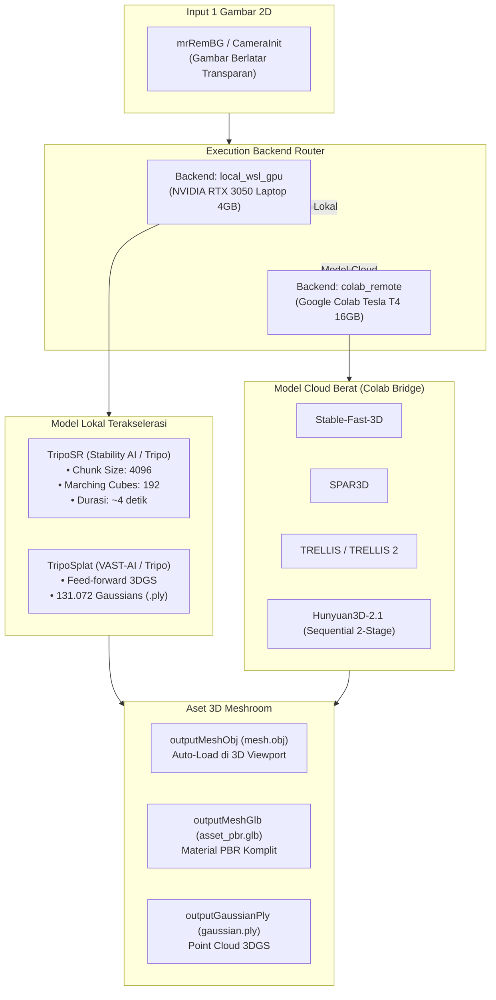
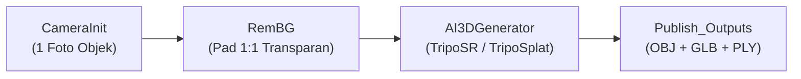

# Walkthrough: Panduan Lengkap Node AI3DGenerator (Single-Image Generative 3D & Gaussian Splatting)

Dokumen ini menyajikan panduan teknis komprehensif mengenai arsitektur, optimasi memori GPU laptop, integrasi pipeline, dan eksekusi node **`AI3DGenerator`** pada [AliceVision Meshroom 2025.1.0+](https://github.com/alicevision/meshroom).

---

## 1. Ikhtisar & Arsitektur Sistem Hibrida `mrAIGen3D`

Node `AI3DGenerator` dikembangkan di dalam paket plugin `mrAIGen3D` (`D:\Meshroom\mrAIGen3D`) untuk merevolusi pembuatan aset 3D di Meshroom: **mengubah satu gambar 2D tunggal menjadi model 3D penuh bertekstur (`.obj` dan `.glb`) atau 3D Gaussian Splat (`.ply`) dalam hitungan detik**.

---

## 2. Strategi Eksekusi Memori Rendah (NVIDIA RTX 3050 Laptop 4 GB VRAM)

GPU kelas laptop dengan VRAM 4 GB umumnya mengalami galat *CUDA Out of Memory (OOM)* jika menjalankan model AI 3D generatif standar. Node `AI3DGenerator` menerapkan lima pilar optimasi perangkat keras:

1. **Chunked Rendering Evaluation (`chunk_size = 4096`):**
   Pada model NeRF `TripoSR`, volume densitas dievaluasi dalam potongan (*chunks*) 4.096 piksel, bukan secara monolitik (8.192–16.384). Ini memangkas puncak pemakaian VRAM dari >5,8 GB menjadi **~2,8 GB**.
2. **Marching Cubes Grid Reduction (`mc_resolution = 192`):**
   Resolusi grid marching cubes dioptimalkan ke $192^3$ voxel (menghasilkan ~26.000 vertex dan ~53.000 face), yang menjaga batas aman alokasi buffer tensor VRAM di bawah 4.0 GB sembari mempertahankan ketajaman siluet geometri.
3. **Pembersihan Memori Proaktif:**
   Memanggil `gc.collect()` dan `torch.cuda.empty_cache()` secara eksplisit segera setelah ekstraksi mesh selesai.
4. **Fallback Isosurface Scikit-Image:**
   Jika pustaka C++ `torchmcubes` tidak tersedia, modul isosurface otomatis beralih (*graceful fallback*) ke modul `skimage.measure.marching_cubes` berbasis CPU numpy, mencegah crash sistem.
5. **Compositing RGBA Netral:**
   Gambar bertransparansi dikompositkan di atas latar belakang abu-abu netral ($RGB = 0.5$) sebelum masuk ke vision encoder `DINOv2` sesuai standar resmi Stability AI.

---

## 3. Spesifikasi Parameter Node `AI3DGenerator`

### 3.1 Parameter Input (`inputs`)

| Nama Parameter | Tipe Data | Nilai Default | Pilihan / Rentang | Penjelasan Fungsional |
| :--- | :--- | :--- | :--- | :--- |
| `input` | `desc.File` | `""` | Path berkas | **Single Unified Input**: Menerima koneksi `RemBG.outputSfm`, `CameraInit.output` (`cameraInit.sfm`), folder gambar, atau file gambar individual (`.png`/`.jpg`). |
| `selectedViewIndex` | `desc.IntParam` | `0` | `0` – `1000` | Indeks gambar yang dipilih jika input memuat lebih dari satu foto. |
| `modelName` | `desc.ChoiceParam` | `"triposr"` | `["triposr", "triposplat", "stable-fast-3d", "spar3d", "trellis-large", "trellis-2-4b", "hunyuan3d-2.1"]` | Model rekonstruksi 3D. `triposr` dan `triposplat` berjalan lokal; sisanya memerlukan worker Colab. |
| `executionBackend` | `desc.ChoiceParam` | `"local_wsl_gpu"` | `["local_wsl_gpu", "local_cpu", "colab_remote"]` | Lokasi komputasi inferensi model. |
| `remoteEndpointUrl` | `desc.StringParam` | `""` | URL Publik | URL tunnel Cloudflared/Gradio dari Google Colab jika menggunakan mode remote. |
| `mcResolution` | `desc.ChoiceParam` | `"192"` | `["192", "256", "384"]` | Kerapatan grid ekstraksi poligon TripoSR. |
| `chunkSize` | `desc.ChoiceParam` | `"4096"` | `["2048", "4096", "8192"]` | Ukuran chunk evaluasi NeRF TripoSR (semakin kecil = semakin hemat VRAM). |
| `numGaussians` | `desc.ChoiceParam` | `"131072"` | `["32768", "65536", "131072", "262144"]` | Jumlah titik Gaussian pada model `triposplat`. |
| `textureResolution` | `desc.ChoiceParam` | `"1024"` | `["512", "1024", "2048"]` | Resolusi peta tekstur dalam piksel. |
| `lowVramMode` | `desc.BoolParam` | `True` | `True` / `False` | Mengaktifkan strategi sequential layer unloading pada GPU. |

> [!TIP]
> **Deteksi Transparansi Cerdas (Non-Blocking):**  
> `AI3DGenerator` secara otomatis mendeteksi apakah gambar input memiliki kanal alfa (RGBA transparan). Jika gambar masih memiliki latar belakang padat (opaque RGB), node **tidak akan crash/berhenti**, melainkan tetap memproses gambar dan menampilkan panduan informatif di log Meshroom agar pengguna mempertimbangkan menghubungkan node `RemBG` di depan `AI3DGenerator` untuk hasil geometri optimal.

### 3.2 Atribut Output (`outputs`)

| Nama Atribut | Tipe Data | Format & Path Relatif | Integrasi Hilir |
| :--- | :--- | :--- | :--- |
| `outputMeshObj` | `desc.File` | `{nodeCacheFolder}/mesh.obj` | Diberi `semantic="3d"` — **Langsung dirender di 3D Viewport Meshroom** dan menghubungkan ke `MeshFiltering.inputMesh`. |
| `outputMeshGlb` | `desc.File` | `{nodeCacheFolder}/asset_pbr.glb` | File `.glb` lengkap dengan peta material PBR (*albedo*, *roughness*, *metallic*). |
| `outputGaussianPly` | `desc.File` | `{nodeCacheFolder}/gaussian.ply` | Diberi `semantic="3d"` — File 3D Gaussian Splats untuk model `triposplat` atau `trellis`. |
| `outputPreviewPng` | `desc.File` | `{nodeCacheFolder}/preview.png` | Diberi `semantic="image"` — Menampilkan foto input terpilih di **2D Viewer**. |

---

## 4. Topologi Pipeline Bawaan: `AIGen3D.mg`

Template pipeline resmi **`AIGen3D.mg`** dirancang khusus untuk mengubah 1 foto 2D menjadi model 3D penuh secara instan dan bersih:

### Keunggulan Alur `AIGen3D.mg`:
1. **Otomatis Bersih (Zero-Clutter):** Node `RemBG` otomatis memotong latar belakang dan menambahkan padding 1:1 simetris sehingga input yang masuk ke AI 3D bebas dari artefak latar belakang (*bounding box distortion*).
2. **Generasi Kilat (~4 Detik):** Memanfaatkan arsitektur NeRF transformer lokal pada GPU RTX 3050 Laptop (4GB VRAM).
3. **Format Aset Komplit:** Mengekspor langsung Wavefront `.obj` (langsung render di 3D Viewport), glTF `.glb` (PBR texturing lengkap), dan 3D Gaussian Splats `.ply`.

---

## 5. Panduan Eksekusi Langkah demi Langkah (GUI Meshroom)

1. **Jalankan AliceVision Meshroom**:
   Buka `D:\Meshroom\Meshroom-2025.1.0\Meshroom.exe`.
2. **Buka Template Pipeline**:
   Pilih menu bar **Pipelines** $\rightarrow$ **AIGen3D**.
3. **Impor Satu Gambar**:
   *Drag-and-drop* satu foto objek (misalnya `D:\Meshroom\griffin\1.png`) ke panel **Images**.
4. **Pilih Parameter**:
   - Klik node `AI3DGenerator_1`.
   - Pastikan `modelName` diatur ke `triposr` (atau `triposplat`).
   - Pastikan `executionBackend` diatur ke `local_wsl_gpu`.
5. **Mulai Komputasi**:
   Klik tombol **Compute**. Pada GPU RTX 3050 Laptop, eksekusi selesai dalam **~4 detik**.
6. **Melihat Hasil 3D di Layar Kerja (Viewport)**:
   - **Klik dua kali (*double-click*)** pada node `AI3DGenerator_1` (atau pada `MeshFiltering_1`).
   - Objek 3D lengkap dengan warna/tekstur akan langsung muncul di **3D Viewer** Meshroom.
   - Gunakan tombol mouse kiri untuk memutar model (*orbit*), tombol tengah untuk menggeser (*pan*), dan roda mouse untuk memperbesar (*zoom*).

---

## 6. Menggunakan Remote Colab GPU Bridge (Model Besar)

Untuk model besar seperti `SPAR3D`, `TRELLIS-image-large`, atau `Hunyuan3D-2.1`:

1. Buka notebook [Meshroom_AI3D_Colab_Worker.ipynb](file:///d:/Meshroom/mrAIGen3D/colab/Meshroom_AI3D_Colab_Worker.ipynb) di Google Colab.
2. Pilih runtime GPU (**T4 / L4 / A100**).
3. Jalankan seluruh cell di notebook hingga muncul URL Cloudflared publik (misal `https://xxxx.trycloudflare.com`).
4. Pada node `AI3DGenerator` di Meshroom:
   - Atur `modelName` ke model pilihan Anda (contoh `spar3d`).
   - Atur `executionBackend` ke `colab_remote`.
   - Tempelkan URL Cloudflared ke kolom `remoteEndpointUrl`.
5. Klik **Compute**. Meshroom akan mengirim gambar ke Colab dan mengunduh file `.glb` dan `.obj` otomatis ke laptop Anda.

---

## 7. Kepatuhan Hukum & Lisensi Stability AI

Node `AI3DGenerator` mematuhi seluruh klausul **Stability AI Community License Agreement (5 Juli 2024)**:
* **Pemisahan Bobot (*Zero-Weight Bundling*):** Repositori hanya memuat kode wrapper berlisensi MPLv2. Bobot model diunduh saat runtime langsung dari Hugging Face Hub.
* **Atribusi Verbatim:** Repositori menyertakan file [Notice](file:///d:/Meshroom/mrAIGen3D/Notice) dan docstring resmi bertuliskan:
  > *This Stability AI Model is licensed under the Stability AI Community License, Copyright © Stability AI Ltd. All Rights Reserved. Powered by Stability AI.*
