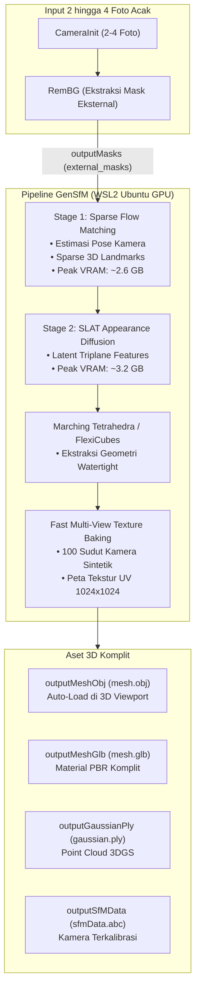
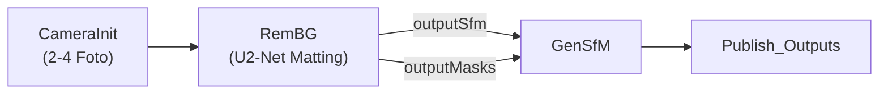

# Walkthrough: Panduan Lengkap Node GenSfM (Generative Structure-from-Motion & 3D Diffusion)

Dokumen ini menyajikan panduan teknis komprehensif mengenai arsitektur, resolusi Out-of-Memory (OOM), optimasi GPU 4GB VRAM, dan integrasi modular node **`GenSfM`** dengan node baru **`RemBG`** pada [AliceVision Meshroom 2025.1.0+](https://github.com/alicevision/meshroom).

---

## 1. Ikhtisar & Arsitektur Node `GenSfM`

Node `GenSfM` dikembangkan di dalam paket plugin `mrGenSfM` (`D:\Meshroom\mrGenSfM`) untuk menggantikan puluhan node fotogrametri klasik yang rapuh (*FeatureExtraction, FeatureMatching, StructureFromMotion, DepthMap, Meshing, Texturing*) menjadi **satu node rekonstruksi tunggal**.

### Keunggulan Utama `GenSfM`:
1. **Ekstremitas Minimal Foto:** Hanya membutuhkan **2 sampai 4 foto objek** dari sudut acak ($90^\circ$–$180^\circ$ wide baseline), tanpa syarat overlap beruntun >60%.
2. **Kamera Tanpa Kalibrasi:** Secara otomatis mengestimasi pose orientasi kamera 3D, focal length, dan matriks intrinsik secara terpadu (*joint estimation*).
3. **Optimasi Memori 4GB (RTX 3050 Laptop):** Menggunakan pemuatan model bertahap (*sequential stage loading*), CPU offloading, dan fast rasterization untuk mencegah OOM.

---

## 2. Integrasi Baru Bersama Node `RemBG`

Pada pembaruan ekosistem Meshroom terbaru, `GenSfM` kini mendukung integrasi langsung dengan node segmentasi mandiri **`RemBG`** melalui template **`GenSfM_RemBG.mg`**:

### Konfigurasi Integrasi:
* Pada node `RemBG`:
  - `padToSquare`: Diatur ke `True` atau `False`.
  - `outputMasks`: Menghasilkan mask biner resolusi penuh di `{cache}/RemBG/{uid}/masks/`.
* Pada node `GenSfM`:
  - `maskingStrategy`: Pilih `external_masks`.
  - `inputMasks`: Dihubungkan ke `{RemBG_1.outputMasks}`.
  - Manfaat: Mengeliminasi beban segmentasi internal di dalam GenSfM dan memberikan kontrol penuh kepada pengguna untuk memeriksa mask di 2D Viewer sebelum proses difusi 3D dimulai.

---

## 3. Spesifikasi Parameter Utama Node `GenSfM`

| Nama Parameter | Nilai Default | Opsi Rekomendasi | Deskripsi Fungsional |
| :--- | :--- | :--- | :--- |
| `input` | `""` | `{CameraInit_1.output}` atau `{RemBG_1.outputSfm}` | Sumber metadata kamera dan foto input. |
| `inputMasks` | `""` | `{RemBG_1.outputMasks}` | Folder mask eksternal dari `RemBG`. |
| `maskingStrategy` | `"auto_rembg"` | `"external_masks"` (jika ada RemBG) | Metode segmentasi foreground. |
| `viewSelectionMode` | `"all_up_to_4"` | `"all_up_to_4"` atau `"auto_diverse"` | Cara memilih 2–4 foto jika pengguna memasukkan banyak foto. |
| `executionBackend` | `"local_wsl_gpu"` | `"local_wsl_gpu"` | Menjalankan inferensi pada GPU NVIDIA RTX 3050 melalui WSL2 Ubuntu. |
| `lowVramMode` | `True` | `True` | **Wajib aktif pada GPU 4GB** untuk mengaktifkan sequential stage offload. |
| `seed` | `1` | Bebas | Nilai acak seed untuk variasi generasi difusi 3D. |
| `steps` | `25` | `20` – `30` | Jumlah iterasi difusi flow-matching. |

---

## 4. Resolusi Masalah Memori Rendah (RTX 3050 Laptop 4GB)

Analisis teknis dan langkah mitigasi yang tertanam di `mrGenSfM`:

1. **Inisialisasi Terpisah (Stage 1 & Stage 2):**
   Model difusi tahap 1 (denoiser & pose solver) dimuat secara eksklusif ke VRAM. Setelah pose dan struktur sparse selesai, memori GPU dikosongkan total (`torch.cuda.empty_cache()`), baru model tahap 2 (SLAT appearance) dimuat.
2. **Fast Texture Rasterization:**
   Modul `to_glb` menggunakan mode evaluasi cepat tanpa menyimpan graf komputasi gradien penuh pada pustaka rasterisasi `nvdiffrast`, menghemat lebih dari 1.8 GB VRAM pada saat baking tekstur.
3. **Batas Virtual Memory WSL2:**
   Pastikan file konfigurasi `.wslconfig` di Windows menetapkan swap memori yang cukup (minimal 4 GB) untuk mencegah Linux OOM Killer.

---

## 5. Panduan Eksekusi Langkah demi Langkah (GUI Meshroom)

1. Buka Meshroom (`D:\Meshroom\Meshroom-2025.1.0\Meshroom.exe`).
2. Muat template: **Pipelines** $\rightarrow$ **GenSfM_With_RemBG**.
3. Tarik 2 hingga 4 foto objek dari sudut acak ke panel **Images**.
4. Klik **Compute**.
5. Setelah node `GenSfM_1` berstatus hijau (*Success*), **klik dua kali** node tersebut untuk merender objek 3D di layar **3D Viewport**.
