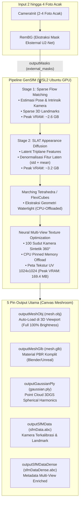
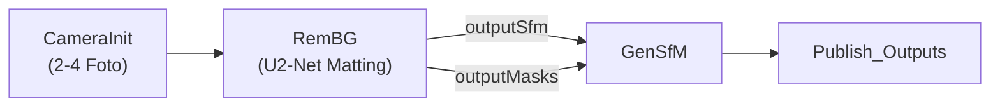

# Walkthrough: Panduan Lengkap Node GenSfM (Generative Structure-from-Motion & 3D Diffusion)

Dokumen ini menyajikan panduan teknis komprehensif mengenai arsitektur, resolusi Out-of-Memory (OOM), optimasi GPU 4GB VRAM, fidelitas tekstur fotorealistik, dan integrasi modular node **`GenSfM`** dengan node baru **`RemBG`** pada [AliceVision Meshroom 2025.1.0+](https://github.com/alicevision/meshroom).

---

## 1. Ikhtisar & Arsitektur Node `GenSfM`

Node `GenSfM` dikembangkan di dalam paket plugin `mrGenSfM` (`D:\Meshroom\mrGenSfM`) untuk mengompresi puluhan node fotogrametri klasik (*FeatureExtraction $\rightarrow$ FeatureMatching $\rightarrow$ StructureFromMotion $\rightarrow$ PrepareDenseScene $\rightarrow$ DepthMap $\rightarrow$ Meshing $\rightarrow$ Texturing*) menjadi **satu node rekonstruksi AI terpadu**.

### Keunggulan Utama `GenSfM`:
1. **Ekstremitas Minimal Foto:** Hanya membutuhkan **2 sampai 4 foto objek** dari sudut acak ($90^\circ$–$180^\circ$ wide baseline), tanpa syarat overlap berurutan >60%.
2. **Kamera Tanpa Kalibrasi:** Secara otomatis mengestimasi pose orientasi kamera 3D, focal length, dan matriks intrinsik secara terpadu (*joint estimation*).
3. **Tekstur & Penampilan Fotorealistik:** Dilengkapi native neural multi-view texture optimization dan denormalisasi laten penuh yang menghasilkan warna dan detail tekstur tajam setara upstream Colab.
4. **Optimasi Memori 4GB (RTX 3050 Laptop / GTX 1650):** Menggunakan pemuatan model bertahap (*sequential stage offload*), CPU host pinned memory offloading, dan FlexiCubes CPU extraction untuk memastikan proses berjalan stabil tanpa OOM.

---

## 2. Integrasi Bersama Node `RemBG`

Pada ekosistem Meshroom terbaru, `GenSfM` mendukung integrasi langsung dengan node segmentasi mandiri **`RemBG`** melalui template resmi **`GenSfM_RemBG.mg`**:

### Konfigurasi Integrasi:
* Pada node `RemBG`:
  - `padToSquare`: Diatur ke `True` atau `False`.
  - `outputMasks`: Menghasilkan mask biner resolusi penuh di `{cache}/RemBG/{uid}/masks/`.
* Pada node `GenSfM`:
  - `maskingStrategy`: Pilih `external_masks`.
  - `inputMasks`: Dihubungkan ke `{RemBG_1.outputMasks}`.
  - **Manfaat:** Mengeliminasi beban segmentasi internal di dalam GenSfM dan memberikan kontrol penuh kepada pengguna untuk memeriksa mask di 2D Viewer sebelum proses difusi 3D dimulai.

---

## 3. Spesifikasi Parameter Utama Node `GenSfM`

| Nama Parameter | Nilai Default | Opsi Rekomendasi | Deskripsi Fungsional |
| :--- | :--- | :--- | :--- |
| `input` | `""` | `{CameraInit_1.output}` atau `{RemBG_1.outputSfm}` | Sumber metadata kamera dan foto input. |
| `inputMasks` | `""` | `{RemBG_1.outputMasks}` | Folder mask eksternal dari `RemBG`. |
| `maskingStrategy` | `"auto_rembg"` | `"external_masks"` (jika ada RemBG) | Metode segmentasi foreground (`auto_rembg`, `existing_alpha`, `external_masks`). |
| `viewSelectionMode` | `"all_up_to_4"` | `"all_up_to_4"` atau `"auto_diverse"` | Cara memilih 2–4 foto jika pengguna memasukkan banyak foto ke galeri. |
| `executionBackend` | `"local_wsl_gpu"` | `"local_wsl_gpu"` | Menjalankan inferensi pada GPU NVIDIA lokal melalui WSL2 Ubuntu. |
| `lowVramMode` | `True` | `True` | **Wajib aktif pada GPU 4GB** untuk mengaktifkan sequential stage offload. |
| `optimizeTexture` | `True` | `True` | **Mengaktifkan native neural multi-view texture optimization** untuk UV atlas tajam dan detail. Jika dimatikan (`False`), menggunakan draft inpainting cepat. |
| `seed` | `1` | Bebas | Nilai acak seed untuk variasi generasi difusi 3D deterministik. |
| `steps` | `25` | `20` – `30` | Jumlah iterasi difusi flow-matching. |

---

## 4. Arsitektur Low-VRAM & Fidelitas Visual (RTX 3050 Laptop 4GB)

Analisis teknis dan langkah mitigasi yang tertanam di `mrGenSfM`:

1. **Inisialisasi Bertahap (*Sequential Stage Offloading*):**
   - Model difusi Tahap 1 (`denoiser`, `ss_decoder`, `suv_decoder`, dan model `DINOv2`) dimuat untuk memecahkan pose kamera dan sparse structure.
   - Begitu selesai, seluruh model Tahap 1 dibersihkan dari VRAM (`del` & `gc.collect()`), kemudian VRAM dikosongkan total (`torch.cuda.empty_cache()`), baru model Tahap 2 (`slat_denoiser`) dimuat ke VRAM.
2. **Denormalisasi Laten Fitur Stage 2 ($\text{pred\_x\_0} \times \text{std} + \text{mean}$):**
   - Mengembalikan tensor laten hasil difusi flow-matching ke ruang distribusi fitur sebenarnya ($\mu \approx -2.168, \sigma \approx 2.377$).
   - Menghilangkan anomali warna gelap/coklat polos, memulihkan warna asli (*vibrant spherical harmonics*) pada 3D Gaussian Splats dan 100 sudut pandang multi-view render.
3. **Ekstraksi Geometri FlexiCubes via CPU Offload:**
   - Decoder mesh memindahkan modul ekstraksi isosurface `SparseFeatures2Mesh` ke RAM CPU.
   - Menghilangkan lonjakan alokasi grid padat sebesar ~2.5 GB pada VRAM sehingga decoding geometri berlangsung mulus pada GPU 4GB.
4. **Optimasi Tekstur Neural Hemat Memori (*CPU Host Pinned Memory Offload*):**
   - 100 observasi kamera sintetik dan mask disimpan di memori CPU host bertipe `pin_memory()`.
   - Selama 2000 iterasi optimasi Adam, hanya 1 sudut pandang observasi yang ditransfer ke VRAM per langkah secara `non_blocking`.
   - Mengurangi *peak VRAM* proses baking tekstur dari **>3.700 MB** menjadi hanya **169.4 MB**, mencegah crash CUDA OOM pada GPU 4GB dengan hasil tekstur tajam maksimal.
5. **Format Material Wavefront OBJ Standar Assimp:**
   - Parameter material `mesh.mtl` diset ke `Kd 1.000000 1.000000 1.000000` (reflektivitas diffuse penuh 100%) dan `Ka 0.200000`.
   - Direktif `usemtl GenSfMMaterial` dan `s 1` diposisikan tepat di atas pendefinisian poligon `f ...` pada `mesh.obj`, menjamin Qt3D Viewer Meshroom merender material tekstur dengan terang dan jelas.

---

## 5. Struktur Pin Output Terpadu

Node `GenSfM` mengadopsi antarmuka grafis yang bersih dengan mengelompokkan output ke dalam **5 Pin Utama** pada kanvas node, sementara 8 file bantu tetap dapat diakses di panel atribut *Advanced*:

### A. Pin Utama (Canvas Node)
1. **`outputMeshObj` (`mesh.obj`):** Mesh bertekstur utama yang langsung di-load dan ditampilkan di 3D Viewer Meshroom.
2. **`outputSfMData` (`sfmData.abc`):** File Alembic berisi posisi kamera dan sparse landmarks.
3. **`outputMeshGlb` (`mesh.glb`):** Format biner glTF 2.0 standar industri dengan tekstur PBR tertanam.
4. **`outputGaussianPly` (`gaussian.ply`):** Point cloud 3D Gaussian Splats dengan warna spherical harmonics.
5. **`outputSfMDataDense` (`sfmDataDense.abc`):** Metadata kamera Alembic yang diperkaya untuk integrasi pipeline fotogrametri lanjutan.

### B. Pin Lanjutan (Advanced Mode)
- `outputMeshMtl` (`mesh.mtl`), `outputMeshTexture` (`mesh_texture.png`), `outputCamerasJson` (`cameras.json`), `outputMaskedInputs` (`input-rgba-*.png`), `outputReprojections` (`reprojection-*.png`), `outputSfMDataJson` (`sfmData.sfm`), `outputReprojectionByView`, `outputMaskByView`.

---

## 6. Panduan Eksekusi Langkah demi Langkah (GUI Meshroom)

1. Buka Meshroom (`D:\Meshroom\Meshroom-2025.1.0\Meshroom.exe`).
2. Muat template: **Pipelines** $\rightarrow$ **GenSfM_RemBG** (atau **GenSfM**).
3. Tarik 2 hingga 4 foto objek dari sudut acak ke panel **Images**.
4. Klik **Compute**.
5. Setelah node `GenSfM_1` berstatus hijau (*Success*), **klik dua kali** node tersebut untuk merender objek 3D bertekstur penuh di layar **3D Viewport**.
