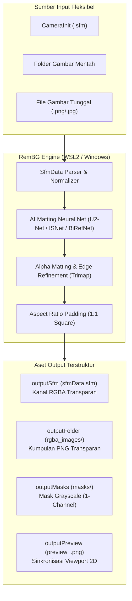
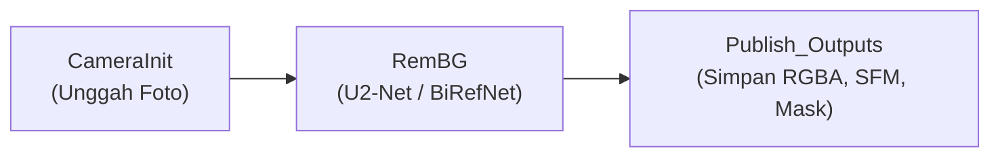
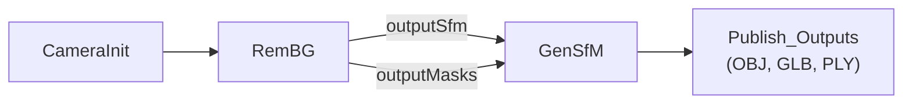

# Walkthrough: Panduan Lengkap Node RemBG (AI Background Removal & Foreground Matting)

Dokumen ini menyajikan panduan teknis mendalam mengenai arsitektur, parameter operasional, metode integrasi, dan eksekusi node **`RemBG`** pada [AliceVision Meshroom 2025.1.0+](https://github.com/alicevision/meshroom).

---

## 1. Ikhtisar & Arsitektur Node `RemBG`

Node `RemBG` dikembangkan secara modular di dalam paket plugin `mrRemBG` (`D:\Meshroom\mrRemBG`) untuk mengatasi salah satu tantangan terbesar dalam fotogrametri dan rekonstruksi 3D generatif: **kebisingan latar belakang (*background clutter*)**.



### Keunggulan Utama `RemBG`:
1. **Preservasi Metadata Kamera AliceVision**: Mengurai file `cameraInit.sfm`, memproses setiap sudut pandang (*view*), dan menuliskan kembali `sfmData.sfm` baru yang mengarahkan path gambar ke PNG berkanal alpha tanpa merusak metadata sensor kamera, intrinsik, maupun orientasi pose.
2. **Dual-Runtime Execution**: Mendukung eksekusi terakselerasi CUDA 12.8 via WSL2 Ubuntu (menggunakan environment conda `gensfm`), serta fallback native Python Windows dan CPU.
3. **Kompatibilitas Multi-Pipeline**: Menghasilkan output ganda (*transparent RGBA images* dan *grayscale alpha masks*) yang dapat dihubungkan langsung ke node `mrGenSfM` maupun `mrAIGen3D`.

---

## 2. Spesifikasi Parameter Node `RemBG`

Berikut adalah rincian seluruh parameter input dan output pada antarmuka Meshroom:

### 2.1 Parameter Input (`inputs`)

| Nama Parameter | Tipe Data | Nilai Default | Pilihan / Rentang | Penjelasan Fungsional |
| :--- | :--- | :--- | :--- | :--- |
| `input` | `desc.File` | `""` | Path berkas / folder | **Single Unified Input**: Menerima koneksi `CameraInit.output` (`cameraInit.sfm`), direktori folder gambar, atau file gambar individual (`.png`, `.jpg`, `.webp`, `.bmp`). |
| `model` | `desc.ChoiceParam` | `"u2net"` | `["u2net", "u2netp", "isnet-general-use", "birefnet-general"]` | Arsitektur neural network untuk segmentasi foreground. `u2net` untuk akurasi umum; `u2netp` untuk kecepatan tinggi; `isnet` untuk boundary tajam. |
| `alphaMatting` | `desc.BoolParam` | `False` | `True` / `False` | Mengaktifkan estimasi trimap dan guided filter matting untuk menghaluskan tepian rambut, bulu halus, dan objek semi-transparan. |
| `alphaMattingForegroundThreshold` | `desc.IntParam` | `240` | `0` – `255` | Nilai ambang batas piksel pasti foreground pada trimap. |
| `alphaMattingBackgroundThreshold` | `desc.IntParam` | `10` | `0` – `255` | Nilai ambang batas piksel pasti background pada trimap. |
| `alphaMattingErodeSize` | `desc.IntParam` | `10` | `1` – `50` | Ukuran radius erosi morfologi untuk membentuk zona ketidakpastian trimap. |
| `padToSquare` | `desc.BoolParam` | `False` | `True` / `False` | Menambahkan padding transparan simetris agar gambar output berasio 1:1 (*square*). Sangat direkomendasikan saat gambar akan dimasukkan ke model 3D AI (`TripoSR` atau `GenSfM`). |
| `executionBackend` | `desc.ChoiceParam` | `"local_wsl_gpu"` | `["local_wsl_gpu", "local_windows", "local_cpu"]` | Lingkungan runtime pemrosesan. Default menggunakan GPU NVIDIA via WSL2 Ubuntu. |
| `wslDistro` | `desc.StringParam` | `"Ubuntu"` | Nama distro WSL2 | Target distribusi Linux WSL2 pada sistem Windows. |
| `wslCondaEnv` | `desc.StringParam` | `"gensfm"` | Nama conda env | Environment conda Linux yang memuat pustaka `rembg` dan PyTorch CUDA. |

### 2.2 Atribut Output (`outputs`)

| Nama Atribut | Tipe Data | Format & Path Relatif | Integrasi Hilir |
| :--- | :--- | :--- | :--- |
| `outputSfm` | `desc.File` | `{nodeCacheFolder}/sfmData.sfm` | Menghubungkan ke `AI3DGenerator.input` atau `GenSfM.input` (dengan `maskingStrategy = 'existing_alpha'`). |
| `outputFolder` | `desc.File` | `{nodeCacheFolder}/rgba_images` | Direktori berisi seluruh file PNG berlatar transparan (`*_rgba.png`). |
| `outputMasks` | `desc.File` | `{nodeCacheFolder}/masks` | Direktori berisi seluruh mask biner grayscale (`*_mask.png`). Menghubungkan langsung ke `GenSfM.inputMasks` (`maskingStrategy = 'external_masks'`). |
| `outputPreview` | `desc.File` | `{nodeCacheFolder}/preview_<VIEW_ID>.png` | Diberi `semantic="image"` agar hasil segmentasi langsung tampil di panel **2D Viewer** Meshroom. |

---

## 3. Integrasi Pipeline Meshroom

Plugin `mrRemBG` menyertakan 2 template pipeline bawaan yang dapat langsung dibuka dari menu **Pipelines** di Meshroom:

### 3.1 Template 1: `RemBG.mg` (Segmentasi Mandiri)
Digunakan untuk mengekstrak foreground dari sekumpulan foto objek dan mengekspor hasilnya ke direktori proyek:


### 3.2 Template 2: `GenSfM_RemBG.mg` (Integrasi Fotogrametri AI)
Menghubungkan `RemBG` ke node rekonstruksi 3D sparse `GenSfM`. Dengan topologi ini, segmentasi dilakukan di tahap awal dengan presisi tinggi, dan mask grayscale dioperkan langsung ke `GenSfM`:

*Konfigurasi pada node `GenSfM`:*
- `maskingStrategy`: Diatur ke `external_masks`.
- `inputMasks`: Otomatis menerima `{RemBG_1.outputMasks}`.

---

## 4. Panduan Eksekusi Langkah demi Langkah (GUI Meshroom)

1. **Jalankan AliceVision Meshroom**:
   Buka `D:\Meshroom\Meshroom-2025.1.0\Meshroom.exe`.
2. **Buka Template Pipeline**:
   Pilih menu bar **Pipelines** $\rightarrow$ **RemBG** (atau **GenSfM_RemBG**).
3. **Impor Gambar**:
   *Drag-and-drop* satu atau beberapa foto objek (contoh dari `D:\Meshroom\griffin\*.png`) ke panel **Images**.
4. **Konfigurasi Parameter `RemBG`**:
   - Klik node `RemBG_1` pada **Graph Editor**.
   - Input slot `input` secara otomatis terhubung dari `CameraInit.output`. Jika ingin memproses file gambar tunggal secara langsung, Anda cukup mengisi path gambar pada kolom `input`.
   - Jika foto memiliki helai rambut halus atau bulu, aktifkan `alphaMatting: True`.
   - Jika output akan dioperkan ke model 3D generatif, aktifkan `padToSquare: True`.
5. **Mulai Komputasi**:
   Klik tombol **Compute** di bagian atas antarmuka Meshroom.
6. **Inspeksi Hasil**:
   - Klik dua kali (*double-click*) pada node `RemBG_1`.
   - Panel **2D Image Viewer** akan langsung menampilkan foto dengan latar belakang terpotong rapi (transparan/checkerboard).
   - Seluruh hasil tersimpan di folder cache node `{cache}/RemBG/{uid}/rgba_images/`.

---

## 5. Eksekusi Mandiri via Command Line (CLI)

Node `RemBG` dapat dijalankan di luar GUI Meshroom menggunakan runner CLI Python:

```bash
# Menjalankan pemrosesan pada satu gambar (Windows / WSL2)
python D:/Meshroom/mrRemBG/cli/mr_rembg_runner.py \
    --images D:/Meshroom/griffin/1.png \
    --output-rgba-dir D:/Meshroom/mrRemBG/tests/out_rgba \
    --output-mask-dir D:/Meshroom/mrRemBG/tests/out_mask \
    --model u2net \
    --pad-to-square
```

---

## 6. Verifikasi & Pengujian Otomatis

Untuk memastikan bahwa seluruh subsistem (I/O SfMData, normalisasi path Windows-WSL, dan inferensi GPU) berfungsi 100%, jalankan test suite resmi:

```powershell
C:\Users\Nyfa\miniconda3\python.exe D:\Meshroom\mrRemBG\tests\test_rembg.py
```
*Hasil yang Diharapkan:*
```text
Ran 3 tests in 7.048s
OK
```
